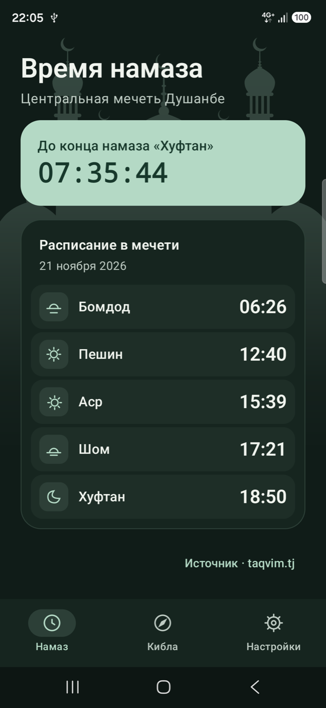
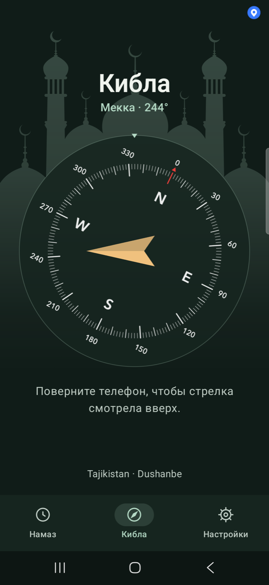
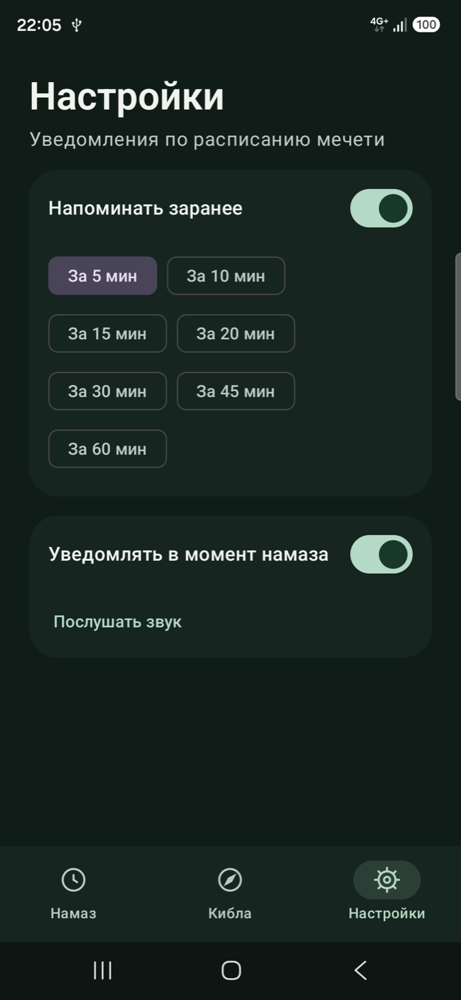

<h1 align="center">Shah</h1>

<p align="center"><strong>Расписание намазов Душанбе и компас киблы для Android</strong></p>
<p align="center">Kotlin · Jetpack Compose · Android 10+</p>

## Скриншоты

| Намаз | Кибла | Настройки |
| :---: | :---: | :---: |
|  |  |  |

## Возможности

- **Намаз.** Расписание коллективных молитв в Центральной мечети Душанбе и обратный отсчёт до начала или конца времени намаза. Приложение сохраняет загруженное расписание на текущий день.
- **Кибла.** Компас показывает направление на Мекку по геопозиции и датчикам телефона.
- **Напоминания.** Можно включить уведомление заранее, в момент намаза или в обоих случаях.

## Сборка и запуск

Открой папку проекта в Android Studio, дождись синхронизации Gradle и запусти конфигурацию `app` на устройстве с Android 10 или новее. Для проверки компаса используй телефон с датчиками ориентации.

Для сборки из терминала нужны JDK 21 и Android SDK 36.1.

```bash
./gradlew :app:assembleDebug
```

Готовый APK появится в `app/build/outputs/apk/debug/app-debug.apk`. Запустить модульные тесты можно командой `./gradlew :app:testDebugUnitTest`.

## Источник расписания

Shah загружает расписание для Душанбе из HTML-страницы taqvim.tj. Время отображается по часовому поясу Душанбе. [Расписание на taqvim.tj](https://taqvim.tj/main_namaz_tj.php)
