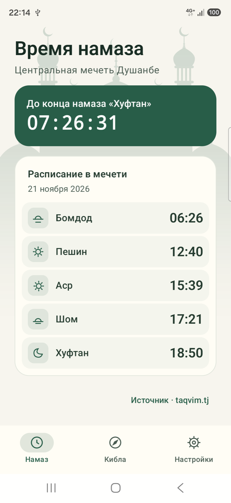
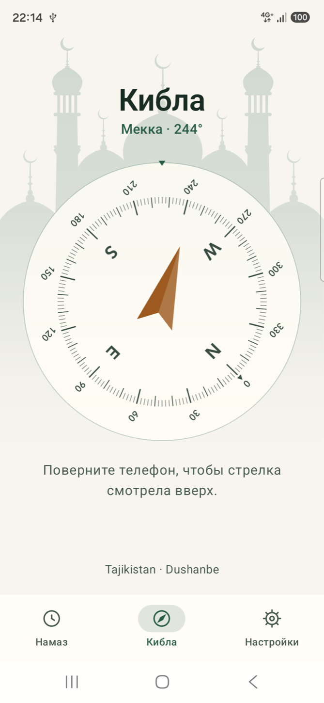
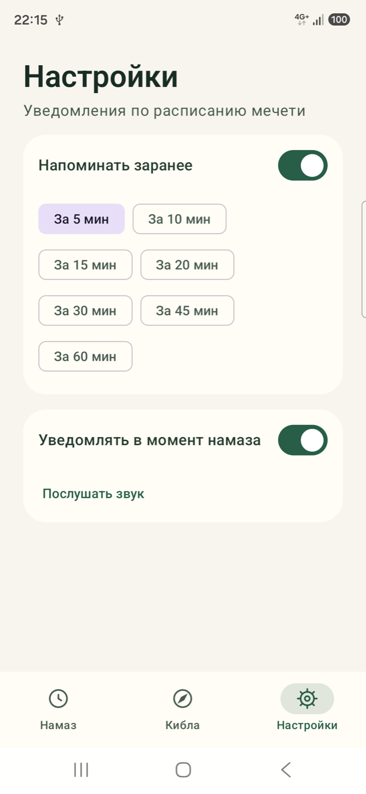

<h1 align="center">Shah</h1>

<p align="center"><strong>Dushanbe prayer times and a Qibla compass for Android</strong></p>
<p align="center">Kotlin · Jetpack Compose · Android 10+</p>

## Screenshots

| Prayer Times | Qibla | Settings |
| :---: | :---: | :---: |
|  |  |  |

## Features

- **Prayer times.** See the congregational prayer schedule for the Central Mosque of Dushanbe and a countdown to the start or end of the prayer window. The app caches the current day's schedule.
- **Qibla.** Find the direction to Mecca using your location and your phone's sensors.
- **Reminders.** Get a notification before prayer, at the scheduled prayer time, or both.

## Build and Run

Open the project in Android Studio, wait for Gradle to sync, and run the `app` configuration on a device with Android 10 or later. To test the compass, use a phone with orientation sensors.

To build from the terminal, use JDK 21 and Android SDK 36.1.

```bash
./gradlew :app:assembleDebug
```

The debug APK is written to `app/build/outputs/apk/debug/app-debug.apk`. Run the unit tests with `./gradlew :app:testDebugUnitTest`.

## Releases and in-app updates

The app checks the latest GitHub Release of `islom-din/Shah` and offers to install a newer APK (Settings → App update).

To publish a release, push a version tag:

```bash
git tag v1.2 && git push origin v1.2
```

The `Release` workflow builds a signed APK and attaches it to the release. It needs these repository secrets (Settings → Secrets and variables → Actions): `KEYSTORE_BASE64` (`base64 -i shah-release.jks`), `KEYSTORE_PASSWORD`, `KEY_ALIAS`, `KEY_PASSWORD`. Every release must be signed with the same key, otherwise Android refuses to update an installed copy.
